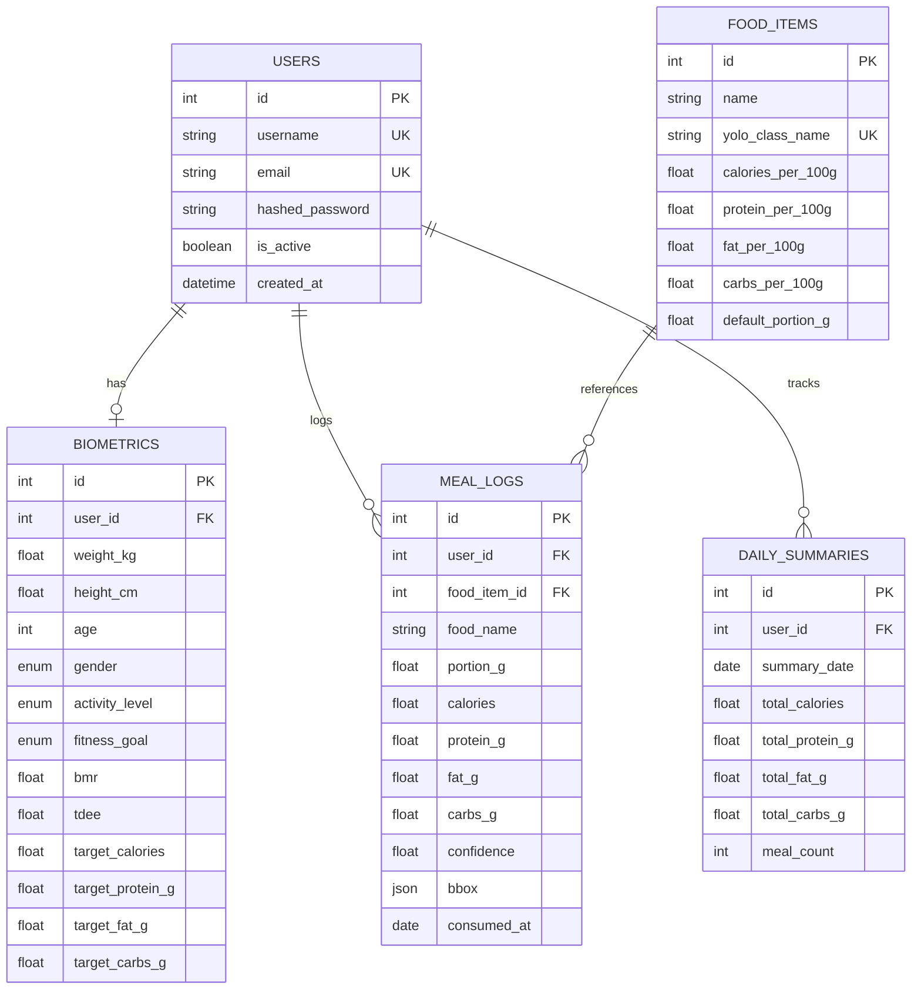

# 🥗 KCapTrack — Vision-Powered Calorie & Macro Tracker

[](https://fastapi.tiangolo.com)
[](https://www.python.org/)
[](https://aistudio.google.com/)
[](https://github.com/ultralytics/ultralytics)
[](https://www.sqlalchemy.org/)
[](LICENSE)

**KCapTrack** is an end-to-end applied AI and nutrition tracking platform. Users scan meal photos or use the live camera, where a dual AI Vision engine (**Google Gemini 2.5/2.0 Flash** + **Ultralytics YOLOv8**) detects food items across any global or regional cuisine (including Indian dishes like Masala Dosa, Sambar, Chutneys, Biryani, Curries), estimates portion masses from bounding-box spatial geometry, scales nutritional profiles (calories, protein, fats, carbs), and dynamically logs intake against personalized **Mifflin-St Jeor** biometric targets.

---

## 📌 Table of Contents
- [1. System Architecture](#1-system-architecture)
- [2. Key Features](#2-key-features)
- [3. Dual AI Vision Pipeline](#3-dual-ai-vision-pipeline)
- [4. Biometric Engine (Mifflin-St Jeor)](#4-biometric-engine-mifflin-st-jeor)
- [5. Database Schema & Models](#5-database-schema--models)
- [6. API Reference](#6-api-reference)
- [7. Technical Interview Talking Points: 2D Volume Estimation Challenges](#7-technical-interview-talking-points-2d-volume-estimation-challenges)
- [8. Quickstart & Installation](#8-quickstart--installation)
- [9. Running the Test Suite](#9-running-the-test-suite)
- [10. Project Directory Structure](#10-project-directory-structure)

---

## 1. System Architecture

```mermaid
graph TD
    Client["Client / Web UI (Single Page App)"] -->|POST /meals/scan (Photo / Live Camera)| API["FastAPI Gateway"]
    Client -->|POST /users/profile| API
    Client -->|GET /dashboard/summary| API

    subgraph "Dual AI Vision Pipeline"
        API --> VisionRouter{"AI Vision Router"}
        VisionRouter -->|Gemini Key Provided / Set| Gemini["Google Gemini 2.5/2.0 Flash<br/>(Global & Regional Cuisines)"]
        VisionRouter -->|Offline / Default| YOLO["Ultralytics YOLOv8n<br/>(Fast Local Object Detection)"]
        YOLO --> NonFoodFilter["Non-Food Suppressor & NMS"]
        NonFoodFilter --> GeometricEst["Portion & Geometric Estimator<br/>(Diameter / Relative Area)"]
        Gemini --> DietitianMapper["Dietitian Macro Estimator"]
        GeometricEst --> NutritionMap["Nutrition Mapping Engine"]
        DietitianMapper --> NutritionMap
    end

    subgraph "Persistence Layer (SQLAlchemy 2.0 Async)"
        NutritionMap -->|Query Class Macros| FoodDB[("food_items Table")]
        NutritionMap -->|Persist Detections| MealLogs[("meal_logs Table")]
        API -->|Calculate & Upsert| SummaryDB[("daily_summaries Table")]
        API -->|Auth & Biometrics| UserDB[("users & biometrics Tables")]
    end

    subgraph "Biometric Engine"
        UserDB --> MSJ["Mifflin-St Jeor BMR & TDEE"]
        MSJ --> Macros["Macro Split Allocation (Cut/Maintain/Bulk)"]
        Macros --> SummaryDB
    end
```

---

## 2. Key Features

* **📷 Dual AI Vision Meal Recognition**:
  * **Google Gemini 2.5/2.0 Flash**: Multi-modal vision recognizing any complex cultural meal (Dosa, Idli, Sambar, Chutney, Biryani, Curries, etc.) with portion and macro breakdown. Free tier (1,500 req/day).
  * **Ultralytics YOLOv8**: Zero-latency offline fallback for standard food classes.
* **📐 Geometric 2D/3D Portion Estimation**:
  * Calculates bounding box footprint relative to total frame resolution.
  * Specialized diameter & cylindrical slab volume estimation for circular items (pizzas, pies, cakes).
  * Non-food tableware & furniture suppression (filters out dining tables, knives, forks, bottles, phones).
  * NMS box containment merge (prevents duplicate slices from overlaying whole pizzas).
* **📸 Live Camera Scanning**: Built-in webcam/mobile camera studio with real-time video preview and snapshot capture.
* **🧬 Mifflin-St Jeor Biometric Engine**: Computes BMR, TDEE, and macro gram allocations based on fitness goals (Cut, Maintain, Bulk).
* **⚡ Async Architecture**: Built on FastAPI and SQLAlchemy 2.0 with asynchronous drivers (`aiosqlite` for zero-config local testing, `asyncpg` for PostgreSQL production).
* **🔒 JWT Authentication**: Secure password hashing with Passlib/Bcrypt and stateless OAuth2 Bearer JWT authorization.
* **📊 Modern Glassmorphism Dashboard**: Live caloric and macro gauge progress, daily meal timeline, and quick-log tools.

---

## 3. Dual AI Vision Pipeline

The food detection pipeline in `app/cv/inference.py` and `app/cv/gemini_vision.py` implements intelligent routing:

1. **Gemini Vision (Primary)**:
   - Uses `google-genai` SDK with auto-discovery (`gemini-2.5-flash`, `gemini-2.0-flash`).
   - Analyzes full plate composition and separates main dishes from side condiments (e.g., Dosa from Sambar and Coconut Chutney).
   - Returns calibrated gram weights and dietitian-grade macronutrients.
2. **YOLO COCO Fallback (Offline)**:
   - Runs pre-trained `yolov8n.pt` with confidence filtering ($\tau = 0.40$).
   - Excludes non-food background objects (tables, chairs, utensils).
   - Computes relative area heuristic:
     $$\text{Relative Area} = \frac{(x_2 - x_1) \times (y_2 - y_1)}{W_{\text{image}} \times H_{\text{image}}}$$
3. **Nutritional Scaling**:
   - Queries `food_items` database table (seeded with 70+ foods including Indian and Western staples) or uses direct multi-modal nutritional estimations.

---

## 4. Biometric Engine (Mifflin-St Jeor)

Calculations in `app/services/biometrics.py` follow validated nutritional science standards:

### Basal Metabolic Rate (BMR)
* **Male**: $\text{BMR} = 10 \cdot W_{\text{kg}} + 6.25 \cdot H_{\text{cm}} - 5 \cdot \text{Age} + 5$
* **Female**: $\text{BMR} = 10 \cdot W_{\text{kg}} + 6.25 \cdot H_{\text{cm}} - 5 \cdot \text{Age} - 161$

### Total Daily Energy Expenditure (TDEE)
$$\text{TDEE} = \text{BMR} \times \text{Activity Multiplier}$$
* Sedentary: $1.2$ | Lightly Active: $1.375$ | Moderately Active: $1.55$ | Very Active: $1.725$ | Extra Active: $1.9$

### Goal-Adjusted Calorie Targets
* **Cut**: $\text{TDEE} \times 0.80$ (20% caloric deficit)
* **Maintain**: $\text{TDEE} \times 1.00$
* **Bulk**: $\text{TDEE} \times 1.15$ (15% caloric surplus)

---

## 5. Database Schema & Models



---

## 6. API Reference

Interactive Swagger documentation is served at `http://localhost:8000/docs`.

### Authentication
* `POST /api/v1/users/register`: Create user account (`username`, `email`, `password`).
* `POST /api/v1/users/login`: Authenticate credentials, receive JWT `access_token`.

### Biometric Profile
* `POST /api/v1/users/profile`: Create/update physical profile (`age`, `gender`, `height_cm`, `weight_kg`, `activity_level`, `fitness_goal`). Automatically computes and returns BMR, TDEE, and macro gram goals.
* `GET /api/v1/users/profile`: Retrieve active biometric profile and targets.

### Computer Vision Meal Scanning
* `POST /api/v1/meals/scan`: Multipart file upload (`file: image`, optional `meal_type`, optional `date`). Executes YOLO inference, estimates portions, persists meal logs, and returns itemized detections and aggregated totals.
* `GET /api/v1/meals/logs`: Retrieve meal scan logs for a given date.

### Daily Dashboard & Progress
* `GET /api/v1/dashboard/summary?summary_date=YYYY-MM-DD`: Returns total consumed calories and macros, compares against target goals, and computes remaining balance and completion percentages.

---

## 7. Technical Interview Talking Points: 2D Volume Estimation Challenges

A major interview question for computer vision nutrition systems is: **"What are the fundamental physical and mathematical limitations of estimating 3D food volume and mass from a single 2D image, and how does KCapTrack handle them?"**

Here are the 3 core limitations and our architectural mitigations:

### 1. Monocular Depth Ambiguity & The Scale Ambiguity Problem
* **The Challenge**: In perspective projection, a small object close to the camera projects the exact same 2D pixel area as a large object further away ($\text{pixel\_size} \propto \frac{\text{real\_size}}{\text{depth}}$). Without depth sensors or a metric scale, a 100g apple close to the lens can appear larger than a 400g melon placed across the table.
* **KCapTrack's Mitigation**:
  * We use **relative area brackets** calibrated against standard dining framing, establishing boundary constraints to prevent runaway errors.
  * In production roadmap, we specify a **fiducial reference object** (e.g. standard coin, credit card, or standardized 26cm dining plate edge detection) or **Monocular Depth Estimation** (such as Depth-Anything / MiDaS) to recover metric scale.

### 2. Volumetric Density & Aeration Discrepancies
* **The Challenge**: 2D images capture surface cross-section, not mass. Two foods with identical 2D bounding boxes can have drastically different densities. For instance, a 15cm bowl of puffed rice or leafy spinach weighs ~40g, whereas a 15cm bowl of dense lasagna or cooked rice weighs ~350g (nearly a 10× differential).
* **KCapTrack's Mitigation**:
  * We decouple the spatial heuristic by maintaining **class-specific default densities and portion priors** in the `food_items` database table (`default_portion_g`).
  * The API response returns both the raw model inference and allows a **Human-in-the-Loop (HITL) portion adjustment**, ensuring the user can confirm or fine-tune gram amounts.

### 3. Occlusion, Hidden Ingredients & 3D Stacking
* **The Challenge**: Real-world meals involve 3D stacking (layers of cheese, gravies, dressings, cooking oils, and butter) that are completely occluded beneath the top surface. A 2D detector cannot see hidden fats and carbs underneath surface layers.
* **KCapTrack's Mitigation**:
  * Our nutrition engine uses **USDA-derived composite meal averages** that incorporate standard preparation oil and seasoning baselines in per-100g profiles.
  * Multi-item meal scanning logs each detected component as an independent entity, enabling incremental meal updates without re-running the entire inference pass.

---

## 8. Quickstart & Installation

### 1. Clone & Set Up Virtual Environment
```bash
git clone https://github.com/yourusername/KCapTrack.git
cd KCapTrack

python -m venv venv
# On Windows:
venv\Scripts\activate
# On Linux/macOS:
source venv/bin/activate
```

### 2. Install Dependencies
```bash
pip install -r requirements.txt
```

### 3. Environment Configuration
Copy `.env.example` to `.env`:
```bash
cp .env.example .env
```
*(By default, SQLite or PostgreSQL connection strings can be configured in `.env`)*

### 4. Database Initialization & Seeding
```bash
python -m app.db.seed
```

### 5. Launch the Server
```bash
uvicorn app.main:app --host 0.0.0.0 --port 8000 --reload
```
Navigate to `http://localhost:8000/docs` to test endpoints via Swagger UI.

---

## 9. Running the Test Suite

Run the automated test suite with pytest:
```bash
pytest tests/ -v
```

All biometric formulas and CV portion heuristics run with zero external dependencies and pass in < 1 second.

---

## 10. Project Directory Structure

```text
KCapTrack/
├── app/
│   ├── api/
│   │   ├── endpoints/
│   │   │   ├── dashboard.py    # Daily summary & progress endpoints
│   │   │   ├── meals.py        # YOLO image scan & logs endpoints
│   │   │   └── users.py        # Registration, login, biometrics CRUD
│   │   ├── deps.py             # OAuth2 current_user dependency
│   │   └── router.py           # Consolidated API router (/api/v1)
│   ├── core/
│   │   ├── config.py           # Pydantic BaseSettings (.env loading)
│   │   ├── enums.py            # Portable domain enums (Gender, Goals, etc.)
│   │   └── security.py         # Passlib bcrypt & python-jose JWT helpers
│   ├── cv/
│   │   └── inference.py        # YOLOv8 pipeline, bbox heuristics, nutrition scaling
│   ├── db/
│   │   ├── models.py           # SQLAlchemy 2.0 ORM models (User, Biometric, FoodItem, MealLog, DailySummary)
│   │   ├── seed.py             # Food nutrition database seeder
│   │   └── session.py          # Async engine & session factory
│   ├── schemas/
│   │   └── schemas.py          # Pydantic v2 schemas for all requests/responses
│   ├── services/
│   │   └── biometrics.py       # Pure Mifflin-St Jeor BMR, TDEE & macro calculations
│   └── main.py                 # FastAPI application, CORS, lifespan, /docs
├── data/
│   └── food_seed.json          # USDA-referenced nutritional seed data (60+ foods)
├── models/                     # YOLO weights directory (auto-downloads yolov8n.pt)
├── tests/
│   ├── test_api.py             # Endpoint integration tests
│   ├── test_biometrics.py      # BMR, TDEE, macro unit tests
│   └── test_cv.py              # Portion heuristic & scaling unit tests
├── legacy/                     # Archived previous Streamlit scripts
├── requirements.txt            # Python dependencies
├── pyproject.toml              # Build & dependency metadata
├── .env.example                # Environment variables template
└── README.md                   # Project documentation
```

---

## 📄 License
MIT License. Developed as a production-grade applied AI and full-stack Python architecture demonstration.
